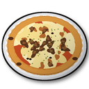
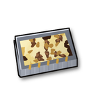
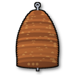

# Verler Leben

**Verler Leben** ist ein Valheim-Mod mit zwei Festmahlen (Feasts) für den Servierteller: der **Spexarder Pizza** und dem **Kaunitzer Teller**. Beide stammen aus der Dönerbude um die Ecke, beide müssen im Steinofen gebacken werden, und beide geben richtig viel Leben und Ausdauer.

<p>
  
  
  
  
</p>

## Was ist ein Feast?

In Valheim gibt es Feasts: ein großes Festmahl aus vielen kleinen Speisen. Du stellst es mit dem **Servierteller** (Feaster, Kategorie „Feasts“) auf einen Tisch, und dann kann jeder in der Runde davon essen. Pro Feast gibt es 10 Portionen. Die Feasts dieser Mod laufen genauso und stehen im selben Baumenü wie die Feasts der Biome.

## Die Festmahle

| Feast | Leben | Ausdauer | Regeneration | Dauer | Portionen |
| --- | --- | --- | --- | --- | --- |
| **Kaunitzer Teller**: Döner und Pommes in der Aluschale, dick mit Käse überbacken. Ein Leben-Essen (rot) | 100 | 50 | 7 | 60 Min. | 10 |
| **Spexarder Pizza**: deftige, fettige Pizza mit ordentlich Dönerfleisch. Ausgeglichen und sehr sättigend | 80 | 80 | 6 | 80 Min. | 10 |

Zum Vergleich: das Feast der Ebenen gibt 55 Leben und 55 Ausdauer für 50 Minuten, das der Nebelwelt 65/65 und das von Ashlands 75/75, jeweils 50 Minuten. Dafür brauchen die Gerichte Zutaten aus den Ebenen, den Bergen und der Nebelwelt. Fleisch und Käse kommen von der Kuh, die du selbst hältst.

## Die Kuh

In den **Wiesen** laufen jetzt Kühe herum, schwarz-weiß gefleckt und kleiner als Lox. Sie sind harmlos: Sie greifen niemanden an und machen keinen Zaun kaputt, ein einfacher Holzzaun reicht.

- **Zähmen:** Wirf Gerste oder Flachs in ihre Nähe und halte Abstand. Nach etwa 5 Minuten ist sie zahm (ein Lox braucht 30).
- **Melken:** Eine zahme, satte Kuh streichelst du mit **E**. Statt „Streicheln“ steht dort „Melken“. Du bekommst 1 bis 2 Milch, danach ist sie einen Tag lang leer. Hat sie Hunger, gibt sie keine Milch.
- **Züchten:** Zwei zahme Kühe, regelmäßig gefüttert und nahe beieinander, bekommen Kälber. Das Kalb wächst nach etwa 20 Minuten heran.
- **Schlachten:** Sie droppt 2 bis 3 Rindfleisch und etwas Lederreste.

## Herstellung

1. **Zutaten** am Essenszubereitungstisch (Food Preparation Table) herstellen:

   | Zutat | Woher / Rezept | Ergibt |
   | --- | --- | --- |
   | Milch | von der zahmen Kuh melken | |
   | Rindfleisch | von der Kuh | |
   | Dönerfleisch | 1 Rindfleisch, 2 gebratenes Wolfsfleisch, 1 Berg-Gewürz | 3 |
   | Käse | 2 Milch | 3 |

2. **Rohes Gericht** am Essenszubereitungstisch herstellen:

   | Gericht | Rezept |
   | --- | --- |
   | Kaunitzer Teller (roh) | 6 Dönerfleisch, 4 Käse, 5 Karotten (die Pommes), 3 Zwiebeln, 2 Jotunn-Pilze, 1 Berg-Gewürz |
   | Spexarder Pizza (roh) | 4 Brotteig, 8 Dönerfleisch, 6 Käse, 4 Wolkenbeeren (die Soße), 2 Magecap-Pilze, 2 Zwiebeln, 1 Berg-Gewürz |

3. **Backen** im Steinofen (Stone Oven), 60 Sekunden. Heraus kommt das fertige Gericht.
4. Mit dem **Servierteller** auf den Tisch stellen und gemeinsam essen.

Das Berg-Gewürz gibt es nicht zu farmen, es kommt wie bei den Feasts aus dem Hauptspiel von der Sumpfhexe. Alle Rezepte, Stationen, Werte und Backzeiten lassen sich in der Config ändern (siehe [Konfiguration](#konfiguration)).

## Schroeders Boonekamp

Der **Verler Boonekamp** der Likör Manufaktur Schroeders vom Kirchplatz in Verl (Rezept seit 1798) ist ein Magenbitter aus 34 Kräutern, Wurzeln und Früchten mit 42 % Vol., in Verl liebevoll „Verler Heimatwasser“ genannt. Der Hersteller empfiehlt ihn „zu kühlem Bier und gutem Essen“. Im Spiel ist er der Verdauungsschnaps nach einem deftigen Feast:

| Wirkung | Wert |
| --- | --- |
| Lebens- und Ausdauer-Regeneration | +30 % / +20 % für 5 Minuten |
| **Während ein Teller oder eine Pizza als Essen aktiv ist** | **+80 % / +50 %** |

Gebraut am **Kessel**: 3 Gerste, 2 Distel, 2 Löwenzahn, 1 Honig, 1 Berg-Gewürz ergeben 2 Flaschen. Er wirkt zusätzlich zu Mets, beides zählt.

## Voraussetzungen

- [BepInExPack_Valheim](https://thunderstore.io/c/valheim/p/denikson/BepInExPack_Valheim/) 5.4.2333 oder neuer
- [Jotunn](https://thunderstore.io/c/valheim/p/ValheimModding/Jotunn/) 2.30.2 oder neuer

Im **Multiplayer** müssen alle Spieler und der Server den Mod in derselben Version haben, sonst verweigert Jotunn die Verbindung.

## Installation

Die fertige Mod ist ein Zip `VerlerLeben-<version>.zip` mit `plugins/VerlerLeben.dll` sowie `manifest.json` und `icon.png` für Mod-Manager. Du bekommst es von der [Release-Seite](https://github.com/Stanni97/verler-leben/releases/latest) oder baust es selbst (siehe [Selbst bauen](#selbst-bauen), das Zip landet dann in `dist/`).

### Mit Mod-Manager (Windows und Linux)

In [r2modman](https://thunderstore.io/c/valheim/p/ebkr/r2modman/) oder [Gale](https://thunderstore.io/c/valheim/p/Kesomannen/GaleModManager/):

1. Ein Valheim-Profil anlegen und darin **BepInExPack_Valheim** und **Jotunn** installieren.
2. Die Zip-Datei mit der Import-Funktion für lokale Mods einbinden (in r2modman: **Settings → Import local mod**).
3. Valheim über den Mod-Manager starten (in r2modman: **Start modded**).

### Manuell unter Windows

1. Den Valheim-Ordner öffnen: in Steam Rechtsklick auf Valheim → **Verwalten** → **Lokale Dateien durchsuchen**.
2. **BepInExPack_Valheim** herunterladen und den *Inhalt* des Ordners `BepInExPack_Valheim` aus der Zip direkt in den Valheim-Ordner kopieren. Danach liegen `BepInEx\`, `winhttp.dll` und `doorstop_config.ini` neben `valheim.exe`.
3. **Jotunn** herunterladen und `plugins\Jotunn.dll` nach `BepInEx\plugins\` kopieren.
4. Den Ordner `BepInEx\plugins\VerlerLeben\` anlegen und `VerlerLeben.dll` hineinkopieren.
5. Valheim ganz normal über Steam starten. Unter Windows sind keine Startoptionen nötig.

### Manuell unter Linux (native Steam-Version)

1. Den Valheim-Ordner öffnen, meist `~/.local/share/Steam/steamapps/common/Valheim`.
2. Den Inhalt von `BepInExPack_Valheim` aus der Zip in diesen Ordner kopieren und das Startskript ausführbar machen:
   ```bash
   chmod +x start_game_bepinex.sh
   ```
3. Jotunn und `VerlerLeben.dll` wie unter Windows ablegen: `BepInEx/plugins/Jotunn.dll` und `BepInEx/plugins/VerlerLeben/VerlerLeben.dll`.
4. In Steam Rechtsklick auf Valheim → **Eigenschaften** → **Startoptionen**:
   ```
   ./start_game_bepinex.sh %command%
   ```
5. Valheim über Steam starten.

**Linux mit Proton:** Wer Valheim per Proton startet (Kompatibilität erzwungen), installiert die Dateien wie unter Windows und setzt als Startoption stattdessen `WINEDLLOVERRIDES="winhttp=n,b" %command%`.

### Dedicated Server

`BepInExPack_Valheim`, `Jotunn.dll` und `VerlerLeben/VerlerLeben.dll` auf dem Server genauso ablegen. Unter Linux startest du den Server mit `start_server_bepinex.sh`, unter Windows ganz normal.

### Funktioniert es?

- In `BepInEx/LogOutput.log` stehen Zeilen wie `Added DF_FeastPizza`.
- Am Essenszubereitungstisch tauchen Dönerfleisch, Käse und die rohen Gerichte in der Rezeptliste auf. Im Steinofen werden die rohen Gerichte gebacken.
- Zum Testen geht auch die Konsole (F5): erst `devcommands`, dann zum Beispiel `spawn DF_Pizza_Material 1`, danach mit dem Servierteller unter „Feasts“ aufstellen.
  Die Prefab-Namen sind `DF_Doener`, `DF_Kaese`, `DF_TellerRaw`, `DF_Teller_Material`, `DF_FeastTeller`, `DF_PizzaRaw`, `DF_Pizza_Material` und `DF_FeastPizza`.

## Konfiguration

Nach dem ersten Start mit dem Mod liegt die Datei `BepInEx/config/felix.verlerleben.cfg` im Valheim-Ordner. Änderungen greifen nach einem Neustart des Spiels.

Die Abschnitte `[Teller]` und `[Pizza]` (die Feasts):

| Schlüssel | Bedeutung |
| --- | --- |
| `Enabled` | Feast an- oder abschalten |
| `CraftingStation` | Wo das rohe Gericht zubereitet wird, Standard `FoodPreparationTable` |
| `Ingredients` | Zutaten als `Prefab:Anzahl`, durch Kommas getrennt, z. B. `BreadDough:3,DF_Doener:6`. Unbekannte Namen landen als Warnung im Log |
| `Amount` | Rohe Gerichte pro Herstellung |
| `BakeSeconds` | Backzeit im Steinofen in Sekunden |
| `Health` / `Stamina` | Leben und Ausdauer pro Portion |
| `HealthRegen` | Lebens-Regeneration, solange das Essen wirkt |
| `DurationSeconds` | Wie lange das Essen wirkt |
| `Servings` | Portionen pro Feast |

Die Abschnitte `[Doener]` und `[Kaese]` (die Zutaten) kennen `Enabled`, `CraftingStation`, `Ingredients` und `Amount`.

Der Abschnitt `[Boonekamp]` hat zusätzlich `DurationSeconds`, `HealthRegenBonusPercent`, `StaminaRegenBonusPercent` sowie `FeastHealthRegenBonusPercent` und `FeastStaminaRegenBonusPercent` für den Bonus nach einem Feast.

Der Abschnitt `[Cow]` schaltet die Kuh ein oder aus (`Enabled`) und stellt Spawn (`SpawnMax`, `SpawnChancePercent`, `GroupMin`, `GroupMax`), Größe und Leben (`Scale`, `Health`), Zähmen und Züchten (`TamingSeconds`, `FedSeconds`, `CalfGrowSeconds`) und das Melken (`MilkCooldownSeconds`, `MilkMin`, `MilkMax`) ein.

Die Prefab-Namen der Vanilla-Zutaten stehen in der [Jotunn-Itemliste](https://valheim-modding.github.io/Jotunn/data/objects/item-list.html).

## Selbst bauen

Du brauchst:

- das [.NET SDK](https://dotnet.microsoft.com/download) 8 oder neuer
  - Windows: Installer von der Microsoft-Seite oder `winget install Microsoft.DotNet.SDK.10`
  - Arch/CachyOS: `sudo pacman -S dotnet-sdk`
- Valheim mit installiertem BepInExPack und Jotunn. Der Build verwendet die DLLs direkt aus dem Spielordner. NuGet-Pakete werden dabei nicht heruntergeladen.

```bash
git clone https://github.com/Stanni97/verler-leben.git
cd verler-leben
dotnet build -c Release
```

Der Build kopiert `VerlerLeben.dll` automatisch nach `BepInEx/plugins/VerlerLeben/` und legt das Release-Zip unter `dist/` ab.

Liegt Valheim nicht im Standard-Steam-Ordner, gibst du den Pfad mit:

```bash
dotnet build -c Release -p:ValheimDir="D:\SteamLibrary\steamapps\common\Valheim"
```

Das automatische Kopieren ins Spiel schaltest du mit `-p:InstallToGame=false` ab.

Bei einer neuen Version die Versionsnummer an zwei Stellen erhöhen: `<Version>` in `VerlerLeben.csproj` und `PluginVersion` in `src/VerlerLebenPlugin.cs`.

Die Icons erzeugt `tools/make_icons.py` (Python 3 mit Pillow):

```bash
python3 tools/make_icons.py Assets 128
python3 tools/make_icons.py /tmp/icons256 256   # danach pizza.png als Thunderstore/icon.png kopieren
```

## Wie es funktioniert

Die Mod nutzt [Jotunn](https://github.com/Valheim-Modding/Jotunn) und klont die Vanilla-Feasts. Pro Gericht entstehen drei Items: das rohe Gericht (am Zubereitungstisch hergestellt), das gebackene Gericht (kommt aus dem Steinofen und ist das, was der Servierteller verbraucht) und das Feast selbst, das auf dem Tisch steht. Die Feasts nutzen die Modelle der Vanilla-Feasts der Wiesen (Teller) und des Schwarzwalds (Pizza). Nur die Icons und Werte sind eigen.

## Automatische Updates

Diese Mod wird vom [Bifrost Updater](https://github.com/Stanni97/bifrost-updater) mit aktualisiert, wenn er installiert ist. Er prüft beim Spielstart das neueste GitHub-Release. Die Mod nennt dafür ihr Repository in der DLL. Der Updater ist optional, die Mod läuft auch ohne.

## Hinweis

Inoffizieller Fan-Mod ohne Verbindung zu Schroeders Likör Manufaktur oder anderen genannten Firmen. Die Namen stehen für Orte und Dinge aus Verl in Ostwestfalen, die Icons sind eigene Zeichnungen. Der Modname erinnert an das „Verler Leben“, die Kirmes in Verl.

## Lizenz

Code und Icons stehen unter der [MIT-Lizenz](LICENSE).
